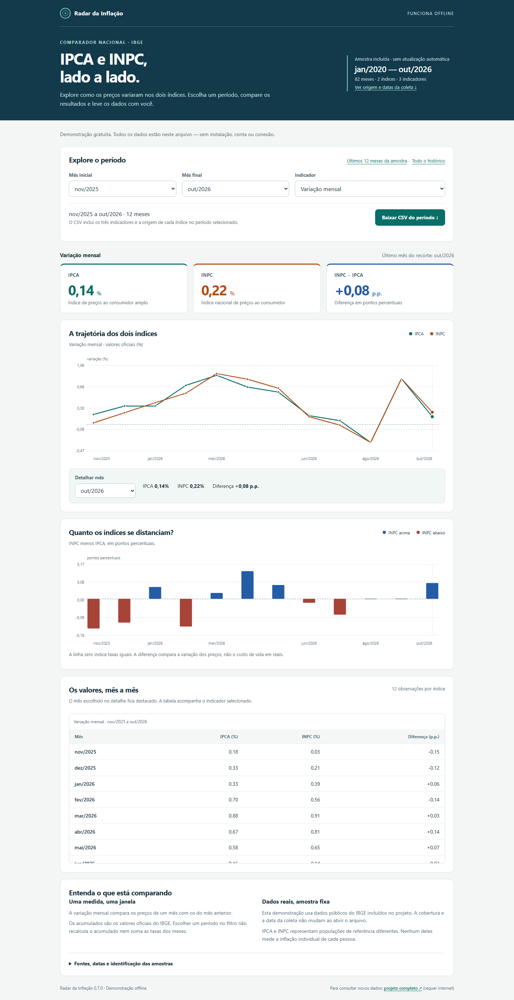
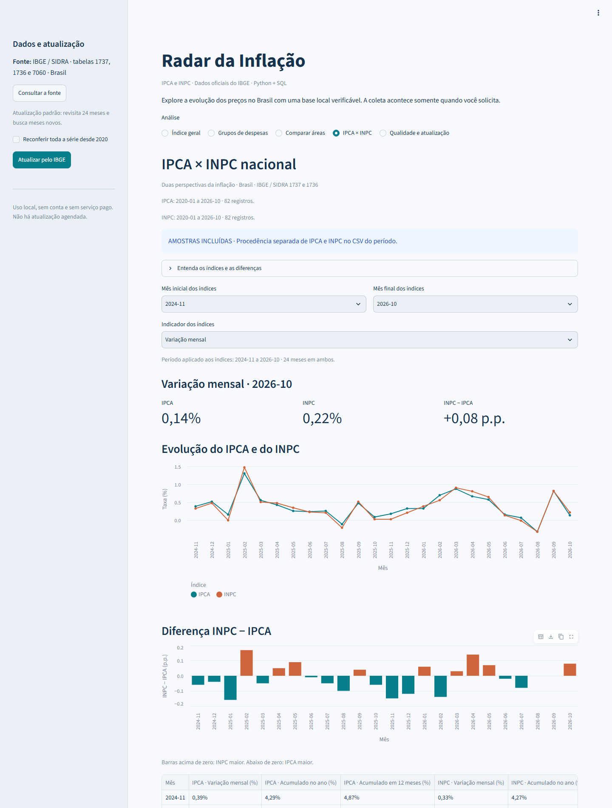
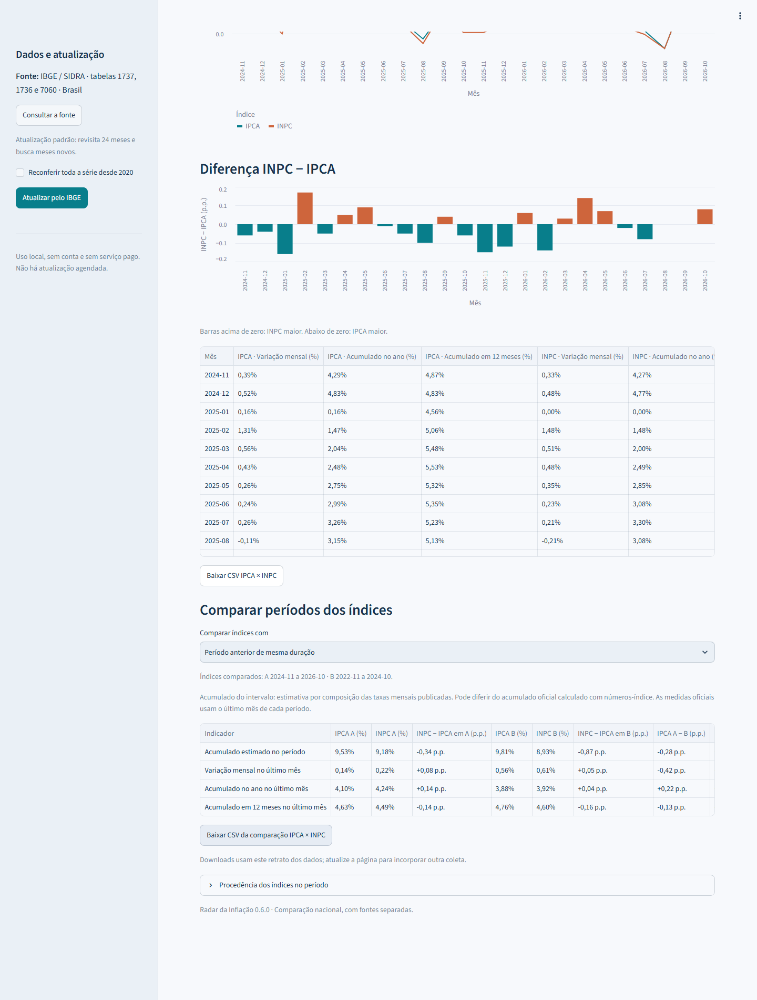
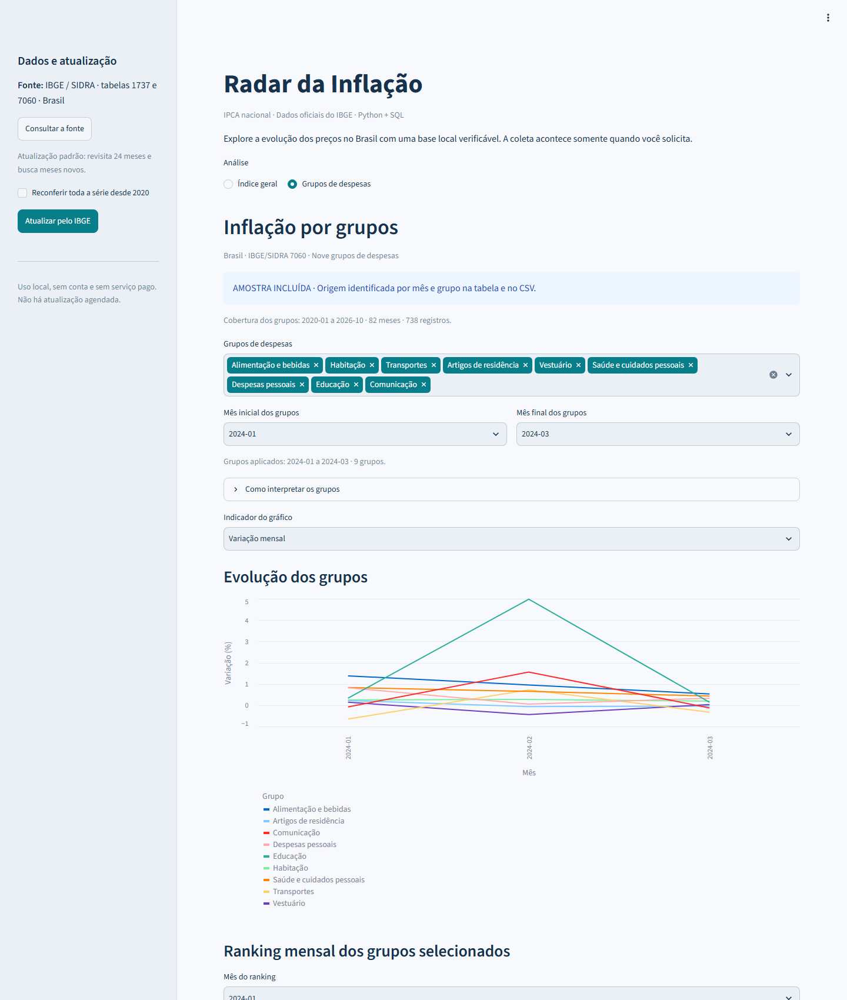
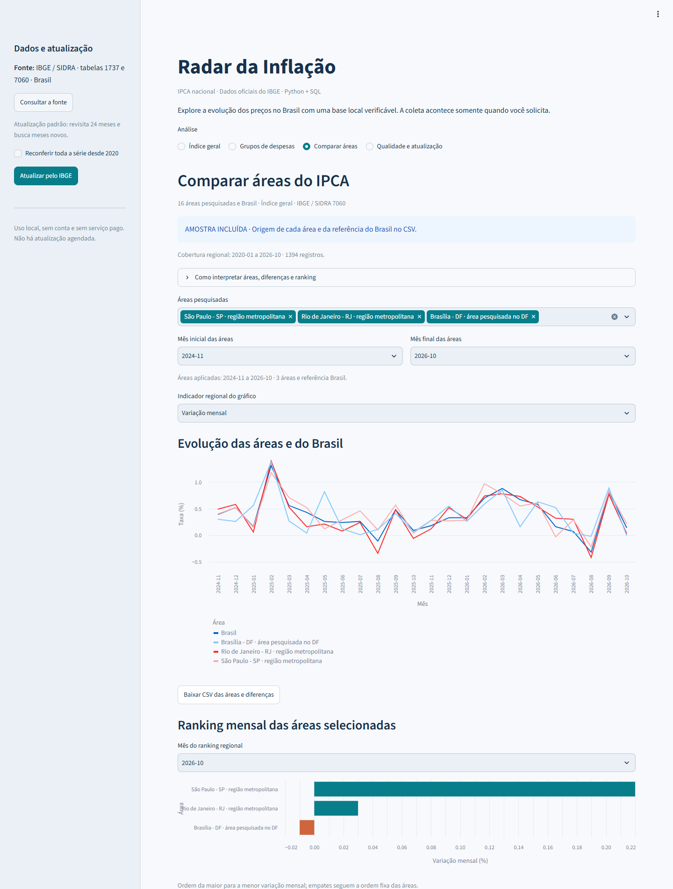
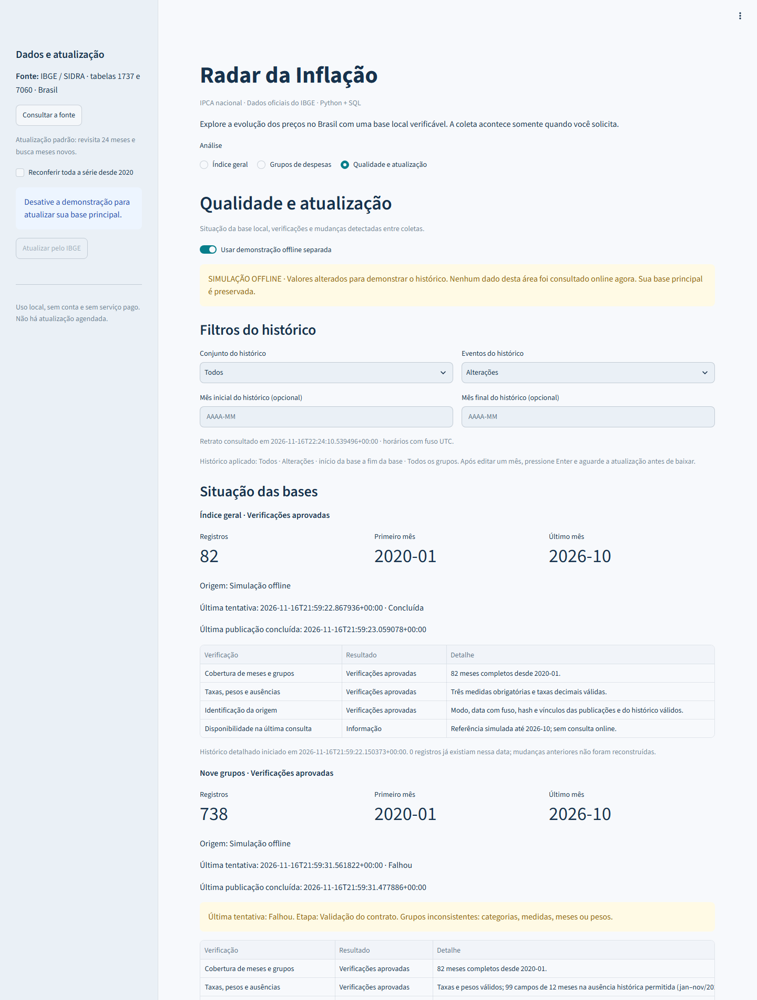

# Radar da Inflação

**[Testar direto no navegador](https://luizcodebr.github.io/RadarInflacao/)** · **[Baixar demonstração offline 0.7.0 (ZIP, cerca de 20 KB)](https://github.com/LuizCodeBR/RadarInflacao/releases/download/v0.7.0/RadarInflacao-Demo-0.7.0.zip)** · [Página da versão](https://github.com/LuizCodeBR/RadarInflacao/releases/tag/v0.7.0)

Compare IPCA × INPC com filtros, gráficos e CSV **sem Python, instalação ou conta**. No site, basta abrir o link e escolher o período. A página precisa de internet para carregar; os filtros, gráficos e CSV são processados no próprio navegador.

**Para guardar uma cópia e usar offline:**

1. **Baixe** `RadarInflacao-Demo-0.7.0.zip`. Você pode salvar no D:.
2. **Extraia** o ZIP. No Windows, clique com o botão direito e escolha **Extrair Tudo**.
3. **Abra** a pasta extraída e dê dois cliques em `ABRIR-DEMONSTRACAO.html` para abrir no navegador.

Escolha o mês inicial, o final e o indicador. Use **Baixar CSV do período** para exportar; escolha o D: ao salvar se quiser manter os arquivos nessa unidade. Mantenha JavaScript habilitado e abra o HTML somente depois de extrair o ZIP.

**Experimente:** selecione outubro/2026 nos dois filtros e **Variação mensal**. A amostra mostra IPCA **0,14%**, INPC **0,22%** e diferença INPC − IPCA **+0,08 p.p.**

A demonstração inclui uma **amostra fixa de janeiro/2020 a outubro/2026**, identificada na tela, sem atualização automática. O ZIP contém apenas HTML e instruções. [Guia completo](docs/OFFLINE.md) · [Publicação no Pages](docs/PAGES.md) · [Validação da versão](docs/VALIDACAO-0.7.0.md).

## Aplicativo completo

Como a inflação medida pelo IPCA se compara à do INPC no mesmo mês? O Radar permite explorar os dois índices nacionais, os nove grupos de despesas e as 16 áreas do IPCA com dados públicos do IBGE. O painel roda no navegador, no seu computador.

O projeto usa **Python, SQL com DuckDB e Streamlit**. A cada atualização, o pipeline confere a estrutura e a origem dos dados, registra o que mudou e preserva a última base válida se a coleta falhar.

**[Baixar código-fonte completo 0.7.0 (ZIP, requer Python)](https://github.com/LuizCodeBR/RadarInflacao/archive/refs/tags/v0.7.0.zip)** · [Notas da versão](https://github.com/LuizCodeBR/RadarInflacao/releases/tag/v0.7.0) · [Testes automatizados](https://github.com/LuizCodeBR/RadarInflacao/actions/workflows/ci.yml)

## Experimente com a amostra incluída

1. **Prepare o projeto.** Com Python 3.12 ou 3.13 instalado, extraia o ZIP em uma pasta onde você possa gravar arquivos.
2. **Abra o painel.** Na pasta extraída, execute `iniciar.cmd` no Windows ou `bash iniciar.sh` no Linux/macOS. A primeira execução usa internet para instalar as dependências. Acesse `http://localhost:8501` no navegador. A amostra funciona offline, sem conta, chave de API ou serviço pago.
3. **Confira um resultado.** Em **Análise**, escolha **IPCA × INPC**. Selecione `2026-10` como mês inicial e final e escolha **Variação mensal**. Na amostra, o IPCA é **0,14%** e o INPC é **0,22%**. A diferença **INPC − IPCA** é de **+0,08 ponto percentual**. Clique em **Baixar CSV IPCA × INPC** para conferir a linha de outubro e a origem de cada índice.

## Experimentar no Windows

Pré-requisito: **Python 3.12 ou 3.13**. Extraia o projeto em pasta gravável, por exemplo D:\Projetos\RadarInflacao. Abra iniciar.cmd ou, no terminal da pasta:

~~~powershell
.\iniciar.cmd
~~~

Abra **http://localhost:8501**. A primeira execução instala dependências fixadas em .venv; precisa de internet. Depois, a amostra incluída permite consultar o painel sem acessar o IBGE. Mantenha o terminal aberto; Ctrl+C encerra.

Para outra porta:

~~~powershell
.\iniciar.cmd -Port 8502
~~~

Se o Python não estiver no PATH, informe seu executável:

~~~powershell
.\preparar.cmd -Python 'D:\Ferramentas\Python\python.exe'
~~~

O caminho acima é um exemplo; use o local da sua instalação. Não exige Node, Docker, PostgreSQL, extensão do VS Code ou hospedagem. Neste computador, o Python foi preparado no D: pelo uv já existente.

## Linux/macOS

Com Python 3.12 ou 3.13 e suporte a venv/pip:

~~~bash
bash iniciar.sh
# Se python3 não for a versão desejada:
RADAR_PYTHON=python3.13 bash iniciar.sh
~~~

A verificação automatizada cobre Windows e Ubuntu, com Python 3.12 e 3.13 em ambos. Consulte o resultado da versão nos [testes automatizados](https://github.com/LuizCodeBR/RadarInflacao/actions/workflows/ci.yml). O iniciador também está disponível para macOS, cuja execução não foi verificada nesta versão.

## O que funciona

- Comparador nacional IPCA × INPC: três medidas oficiais, evolução e diferenças INPC − IPCA em pontos percentuais.
- Comparação A/B com acumulado estimado, janelas oficiais e dois CSVs nacionais com métodos/origem identificados.
- Amostra real do INPC: 82 registros, janeiro/2020 a outubro/2026; atualização e histórico próprios.
- Comparação das 16 áreas do IPCA com o Brasil: evolução, ranking mensal, diferenças em pontos percentuais e comparação A/B.
- Três CSVs regionais com referência oficial do Brasil e procedência dos dados.
- Amostra regional offline: 1394 registros, 82 meses × (16 áreas + Brasil), tabela 7060.

- Amostra real do IBGE: janeiro/2020 a outubro/2026, 82 meses e três medidas por mês.
- Filtros de início/fim, indicadores oficiais, gráfico e tabela com procedência.
- Comparação com período anterior de mesma duração, mesmo período do ano anterior ou intervalo manual.
- Acumulado estimado por composição, diferenças em pontos percentuais e CSV da comparação.
- Explicações contextualizadas e avisos de cobertura, durações diferentes e sobreposição.
- Central de qualidade com verificações locais, última tentativa e última publicação por conjunto.
- Histórico por indicador: inclusões e mudanças, antes/depois, coleta e hash de origem.
- CSV da qualidade e das mudanças filtradas; demonstração offline isolada.
- Análise dos nove grupos: evolução, ranking mensal, peso, comparação A/B e três CSVs.
- Amostra dos grupos com 738 registros (82 meses × nove grupos) e ausência histórica identificada.
- Migração automática dos esquemas 1/2/3/4 para 5, preservando dados e histórico anteriores.
- CSV UTF-8 com BOM, ponto e vírgula e vírgula decimal.
- Atualização sob demanda pela API do IBGE.
- Reconsulta dos últimos 24 meses existentes e busca de meses novos, sem duplicação.
- Reconferência integral desde 2020 para revisões mais antigas.
- Histórico de execuções, arquivos brutos identificados por SHA-256 e gravação transacional.
- Validação de Brasil, tabela, periodicidade, unidade %, três medidas e meses contínuos.
- Falha de rede, JSON inválido ou valor ausente preservam a base válida anterior.
- Bloqueio entre processos para coordenar o arquivo DuckDB.

O painel distingue **amostra incluída**, **base consultada** e **base mista**. Atualizar só uma parte não passa a apresentar toda a série como recém-coletada.

## Atualizar e testar

~~~powershell
.\atualizar.cmd
.\atualizar.cmd -Completo
.\testar.cmd
~~~

No Linux/macOS:

~~~bash
bash atualizar.sh
bash atualizar.sh --full
bash testar.sh
~~~

Atualizar exige internet e acontece somente quando solicitado. Os testes comuns usam respostas controladas e a amostra local, sem depender da rede. O painel também oferece o botão Atualizar pelo IBGE.

## Linha de comando

Depois de preparar o ambiente, no Windows:

~~~powershell
.\.venv\Scripts\python.exe -m radar_inflacao status
.\.venv\Scripts\python.exe -m radar_inflacao demo
.\.venv\Scripts\python.exe -m radar_inflacao export --from 2024-01 --to 2024-03 --output exports\ipca-2024.csv
~~~

Exportação não substitui um arquivo existente. Para usar outra base independente, a opção global vem antes do comando:

~~~powershell
.\.venv\Scripts\python.exe -m radar_inflacao --data-dir .cache\ensaio update --full
~~~

RADAR_DATA_DIR também seleciona a pasta. A amostra não substitui uma base que já contém dados consultados online.

## Fonte e significado dos números

IBGE/SIDRA, **tabela 1737**, Brasil: variável 63 (mensal), 69 (acumulado no ano) e 2265 (12 meses). [Documentação da API](https://servicodados.ibge.gov.br/api/docs/agregados?versao=3) · [Tabela](https://sidra.ibge.gov.br/tabela/1737).

Os acumulados são os divulgados pelo IBGE; não são calculados somando taxas mensais. No ano significa desde janeiro, mesmo se o filtro começar depois. O indicador nacional não representa a inflação individual de cada pessoa.

A [amostra](sample/manifest.json) registra URL, momento da obtenção e hashes dos dados/metadados. Os números do período continuam sendo os publicados pela fonte; não se trata de uma previsão ou medição de preços de produtos.

## Comparar IPCA e INPC — 0.6.0

Em Análise, escolha **IPCA × INPC**. A primeira abertura importa a amostra do INPC sem consultar a rede. Escolha os meses e a medida: mensal, no ano ou em 12 meses. Confira os dois gráficos, a diferença INPC − IPCA e o CSV do período com procedência independente de cada índice.

Compare com período anterior, ano anterior ou intervalo manual. O acumulado do intervalo é estimado pela composição das taxas mensais; as demais medidas são as oficiais do último mês de cada período. A tabela e o CSV mostram IPCA/INPC em A e B, diferenças entre índices e A − B de cada índice.

As coberturas são informadas separadamente. Falta de mês impede o recorte, sem preencher zero ou encurtar silenciosamente. O INPC usa tabela 1736 e variáveis próprias; o IPCA nacional mantém a tabela 1737. Não se misturam com a referência regional da 7060.

A versão 0.6.0 introduziu o comparador, a amostra offline desde janeiro de 2020 e a migração para o esquema 5. [Guia do comparador](docs/INDICES.md) · [Validação da versão 0.6.0](docs/VALIDACAO-0.6.0.md).

Na revisão 0.6.1, o pipeline passou a verificar a procedência antes de publicar cada coleta e a acompanhar o tempo de download. O comparador associa as medidas pelo nome, preserva o indicador após um filtro inválido e exibe os pontos ao selecionar um único mês. A suíte dessa versão passou nos **536 testes**. [Revisão técnica e testes](docs/REVISAO-0.6.1.md).

~~~powershell
.\.venv\Scripts\python.exe -m radar_inflacao demo --dataset inpc
.\.venv\Scripts\python.exe -m radar_inflacao update --dataset inpc
.\.venv\Scripts\python.exe -m radar_inflacao export --dataset indices --from 2024-01 --to 2024-03 --output exports\indices.csv
.\.venv\Scripts\python.exe -m radar_inflacao compare-indices --from 2024-01 --to 2024-03 --from-b 2023-01 --to-b 2023-03 --output exports\indices-ab.csv
~~~

O comando de atualização e o botão do painel incluem agora os quatro conjuntos, com resultado individual. A central tem dezesseis verificações, quatro por conjunto. Antes de importar/abrir o INPC, ele pode aparecer Sem dados. [Guia, método e limites](docs/INDICES.md).

## Explorar os nove grupos

Em Análise, escolha Grupos de despesas. Selecione as categorias e o período A, consulte evolução e ranking mensal e escolha B para comparar. Há CSV do período, do ranking e da comparação. O ranking é de taxas; o peso é uma medida diferente da contribuição ao índice.

Fonte: tabela 7060, Brasil, desde 2020. A amostra inclui 82 meses e quatro medidas por grupo. Os acumulados de 12 meses de janeiro a novembro/2020 não estão disponíveis nessa tabela: aparecem identificados e ficam vazios no CSV, sem virar zero.

Atualizar pelo IBGE e atualizar.cmd atendem ao índice geral e aos grupos. Cada conjunto tem histórico e publicação próprios; eventual sucesso parcial é informado. A migração para esquema 2 preserva os dados nacionais; o código antigo não abre esse esquema.

[Guia dos grupos, dados, CSV e migração](docs/GRUPOS.md) · [Validação 0.3.0](docs/VALIDACAO-0.3.0.md).

## Comparar as 16 áreas — 0.5.0

Em Análise, escolha **Comparar áreas**. A primeira abertura dessa seção importa a amostra regional sem consultar a rede. Selecione uma ou mais áreas, período e indicador do gráfico. O Brasil vem da mesma tabela 7060 e acompanha cada comparação; não é recalculado como média das localidades.

O ranking ordena a variação mensal das áreas selecionadas. A tabela apresenta também acumulados oficiais e diferenças Área − Brasil em pontos percentuais. As áreas representam recortes pesquisados, não todos os municípios ou todo o estado. Maior inflação não significa maior custo de vida.

A comparação A/B mantém as janelas oficiais e identifica o acumulado do intervalo como estimativa por composição das taxas publicadas. Há CSV do período/diferenças, do ranking e da comparação A/B. Downloads usam o mesmo retrato da tela; acumulados em 12 meses de janeiro–novembro/2020 ficam indisponíveis, sem virar zero.

~~~powershell
.\.venv\Scripts\python.exe -m radar_inflacao demo --dataset areas
.\.venv\Scripts\python.exe -m radar_inflacao update --dataset areas
.\.venv\Scripts\python.exe -m radar_inflacao export --dataset areas --areas N7:3501 N6:5300108 --from 2024-01 --to 2024-03 --output exports\areas.csv
~~~

O botão Atualizar pelo IBGE e os comandos demo/update sem --dataset agora incluem os quatro conjuntos. Falhas de um conjunto são informadas sem atribuir sucesso aos demais indevidamente. O lote regional publica suas 16 áreas e o Brasil numa única transação.

A versão 0.5.0 migra o banco para esquema 4, preservando os conjuntos anteriores. Encerre o aplicativo e preserve data/ antes de atualizar outra instalação. Versões até 0.4.1 recusam esquema 4.

[Guia regional](docs/AREAS.md) · [Validação 0.5.0](docs/VALIDACAO-0.5.0.md).

## Qualidade, atualização e histórico — 0.4.1

Em Análise, escolha **Qualidade e atualização**. A central mostra cobertura, taxas/pesos/ausências, procedência, última tentativa e última publicação concluída, separadamente para IPCA nacional, grupos, áreas e INPC nacional. As verificações usam o banco local; não consultam a internet ao abrir filtros.

A disponibilidade corresponde aos últimos metadados registrados: a tela distingue amostra, consulta e simulação, com data. Uma falha após consultar metadados pode avisar que existe mês pendente, sem fazer a base anterior parecer recém-atualizada.

O histórico registra inclusões e alterações por campo, com valor anterior/novo, coleta e hash. Uma reconferência sem diferença não cria alterações. Na primeira importação nacional e dos grupos há 3198 inclusões de campos (82 × 3 + 738 × 4), às quais se somam 4182 regionais; bases existentes começam a registrar o histórico a partir da migração, sem inventar mudanças anteriores.

Para experimentar, ative **Usar demonstração offline separada**. O exemplo prepara duas alterações sintéticas, reconferências sem mudanças e uma coleta inválida recusada em .cache/quality-demo. A base principal é preservada e o CSV identifica Simulação offline. Desative o exemplo para retornar à sua base.

Os filtros por conjunto, evento, mês e grupo afetam o histórico. Há CSV da qualidade e CSV das mudanças filtradas, usando o retrato exibido. O histórico aparece em páginas de 50 eventos; acima de 10000 eventos por consulta é preciso refinar filtros antes de exportar.

~~~powershell
.\.venv\Scripts\python.exe -m radar_inflacao quality
.\.venv\Scripts\python.exe -m radar_inflacao quality-demo
.\.venv\Scripts\python.exe -m radar_inflacao quality-export --output exports\qualidade.csv
.\.venv\Scripts\python.exe -m radar_inflacao quality-export --report changes --kind CHANGED --output exports\mudancas.csv
~~~

Python e dependências permanecem. A versão 0.6.0 usa o esquema 5, preservando dados e histórico anteriores. Antes de atualizar outra instalação, encerre o aplicativo e preserve data. Código até 0.5.1 não abre esquema 5; confira o [guia de instalação](docs/INSTALACAO.md).

**490 testes aprovados no Windows / Python 3.13 e 3.12**, incluindo os 420 anteriores, 62 do INPC/comparador e 8 cenários do coletor aplicados ao INPC. Após a correção visual, os 62 foram repetidos e aprovados em ambos. [Resultados e limites](docs/VALIDACAO-0.6.0.md).

Na revisão 0.4.1, vínculos inválidos deixam de desaparecer do histórico; publicação, procedência e disponibilidade são revalidadas. CSV incompleto, duplicado ou divergente dos filtros é recusado. A demonstração tem verificações de pasta/banco e não pode receber atualizações pela CLI nem ser usada como base principal do painel. Não há nova migração ou dependência.

[Guia da central e dos relatórios](docs/QUALIDADE.md) · [Revisão 0.4.1](docs/REVISAO-0.4.1.md) · [Validação inicial](docs/VALIDACAO-0.4.0.md).

## Comparar períodos e entender os indicadores

1. Escolha os meses inicial e final: eles definem o período A.
2. Em Comparar com, use o período anterior de mesma duração, o mesmo intervalo um ano antes ou Escolher outro período.
3. Consulte o acumulado estimado A/B, a diferença em pontos percentuais e a tabela com as medidas oficiais do último mês de cada intervalo.
4. Abra Entenda os indicadores e os cálculos ou baixe o CSV da comparação.

Exemplo com a amostra: A = janeiro a março/2024, B = janeiro a março/2023. O acumulado estimado de A é 1,4154915776%, exibido como 1,42%. O acumulado oficial no ano de março/2024 continua sendo o 1,42% publicado pelo IBGE.

A estimativa multiplica fatores mensais, sem somar taxas. Como usa taxas já arredondadas, pode diferir do acumulado oficial obtido com números-índice. Os três indicadores oficiais continuam usando suas próprias janelas, mesmo quando o filtro começa em outro mês.

As diferenças são A − B em pontos percentuais, calculadas antes do arredondamento. Períodos de durações diferentes não são anualizados e recebem aviso; intervalos sobrepostos também. Falta de meses impede a comparação, sem encurtar a janela nem ocultar a consulta do período A.

O CSV da comparação registra os dois intervalos, quantidades de meses, taxas, diferenças, métodos e fonte. Ele preserva a precisão do cálculo. A procedência individual de cada mês permanece na tabela e no CSV original do período.

Consulte [métodos e interpretação](docs/COMPARACOES.md).

Na versão 0.2.1, os CSVs validam tipos e procedência antes de gerar o arquivo e mantêm a precisão decimal mesmo em contextos restritivos. Downloads usam os dados já apresentados: atualize a página para consultar uma coleta posterior. A CLI publica um arquivo completo sem substituir um destino existente, mesmo com duas exportações concorrentes.

A publicação pela CLI requer suporte a hard links no volume de destino (validado no D: / NTFS). Em volume sem esse suporte, use o download do navegador ou outro diretório local. Não são necessárias dependências novas. Confira os achados, testes e limites na [revisão 0.2.1](docs/REVISAO-0.2.1.md).

## Revisão dos grupos — 0.3.1

O ranking mantém a precisão mesmo quando o contexto decimal do processo é alterado. Dados locais dos grupos são revalidados antes dos gráficos e cálculos: nomes/IDs, meses, duplicações, taxas, ausências históricas e pesos. Uma inconsistência gera mensagem e impede a análise afetada.

O CSV comparativo confere quatro medidas coerentes com os resumos, diferenças A − B e as mesmas janelas para todos os grupos. Valores ausentes continuam restritos ao acumulado oficial de 12 meses de janeiro–novembro/2020. Os formatos dos CSVs válidos foram preservados.

Os gráficos não alteram configurações globais entre sessões. Se um acumulado sintético extremo exceder a capacidade numérica do gráfico, a interface informa a limitação e mantém a tabela/CSV decimal, sem transformar o resultado em zero.

**229 testes aprovados no Windows / Python 3.13 e 3.12.** Incluem gravação concorrente, interrupção de processo antes do commit, disputa pelo mesmo CSV, dados inválidos e limites numéricos. Em navegador real, os três downloads da sessão anterior permaneceram idênticos durante outra atualização; a nova sessão recebeu os dados publicados. Nenhuma dependência ou migração nova é necessária para quem usa a versão 0.3.0.

[Achados, correções, evidências e limites da revisão](docs/REVISAO-0.3.1.md).

## Arquitetura

~~~mermaid
flowchart LR
    IBGE[API IBGE / tabelas 1737, 1736 e 7060] --> COLETA[Cliente HTTP]
    AMOSTRA[Amostra local identificada] --> VALIDACAO[Validação]
    COLETA --> VALIDACAO
    VALIDACAO --> RAW[Arquivos brutos / SHA-256]
    VALIDACAO --> DB[(DuckDB / transação)]
    DB --> ANALISE[Análise decimal / comparações]
    ANALISE --> PAINEL[Painel Streamlit]
    ANALISE --> COMPARACAO[CSV da comparação]
    DB --> CSV[CSV / procedência]
~~~

[Arquitetura e decisões](docs/ARQUITETURA.md) · [Testes atuais](docs/REVISAO-0.6.1.md) · [Instalação e uso](docs/INSTALACAO.md) · [Dados e limites](docs/DADOS.md).

## Pastas e armazenamento

- src/radar_inflacao/: modelo, fonte, pipeline, persistência, análise, CSV e CLI.
- app.py: interface, sem coleta automática ao consultar filtros.
- sample/: resposta pública do IBGE, metadados e manifesto versionados.
- tests/: regras, rede simulada, banco, concorrência e interface.
- data/: banco, lock e respostas brutas validadas; ignorada pelo Git.
- .venv/ e .cache/: ambiente, downloads, temporários e evidências; ignorados.
- exports/: arquivos gerados; ignorada.

Os iniciadores mantêm ambiente, caches e temporários dentro da pasta do projeto; aqui, no D:. O Python gerenciado foi instalado em D:\Ferramentas\Python\uv-managed. Configurações do editor e do sistema seguem seus próprios locais.

## Limites da versão atual

Séries nacionais desde 2020, tabelas 1737/1736/7060 do IBGE e arquivo local. Atualizações e leituras da aplicação usam o mesmo bloqueio; outra operação em andamento pode pedir nova tentativa. Não é um servidor analítico para vários usuários ou gravação distribuída.

O projeto oferece painel web local responsivo; não publica link externo ou aplicativo nativo nesta entrega. Falhas ficam no histórico, e uma interrupção é sinalizada na próxima abertura. Arquivos brutos não substituem um backup da pasta de dados. Não há tarefa agendada ou serviço pago.

**Critério de conclusão da primeira etapa:** amostra + coleta real + validação + persistência + filtros/CSV + testes + execução simples. A versão 0.6.0 inclui o comparador IPCA × INPC. Novas fontes e automações ficam para uma decisão separada.
