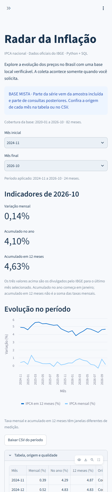

# Capturas da primeira versão

Painel real local da versão 0.1.0. A captura desktop usa janeiro a março/2024 e mostra a amostra; a mobile usa o período padrão depois de uma atualização parcial e identifica a base mista. Não há dados pessoais.

Desktop: viewport 1440 de largura. Mobile: 412 de largura em navegador emulado, sem teste em aparelho físico. Imagens conferidas visualmente; números vêm da API real e da amostra oficial.

