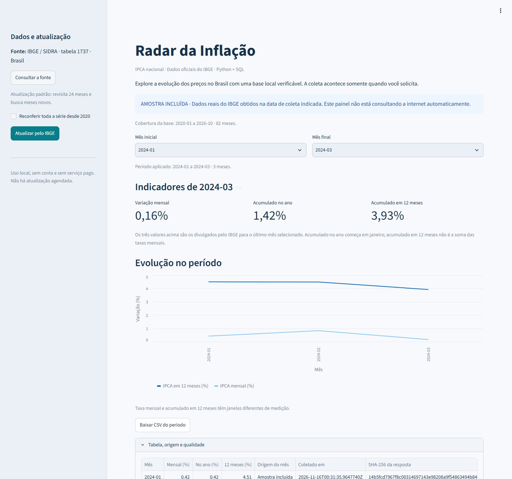
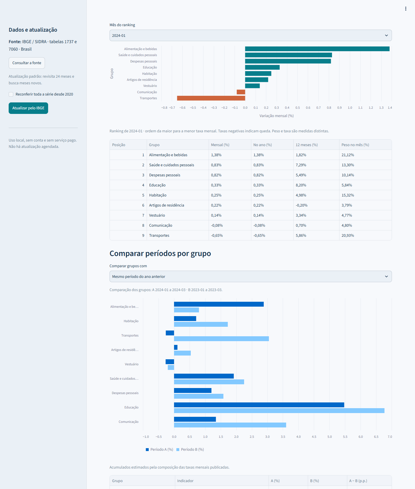
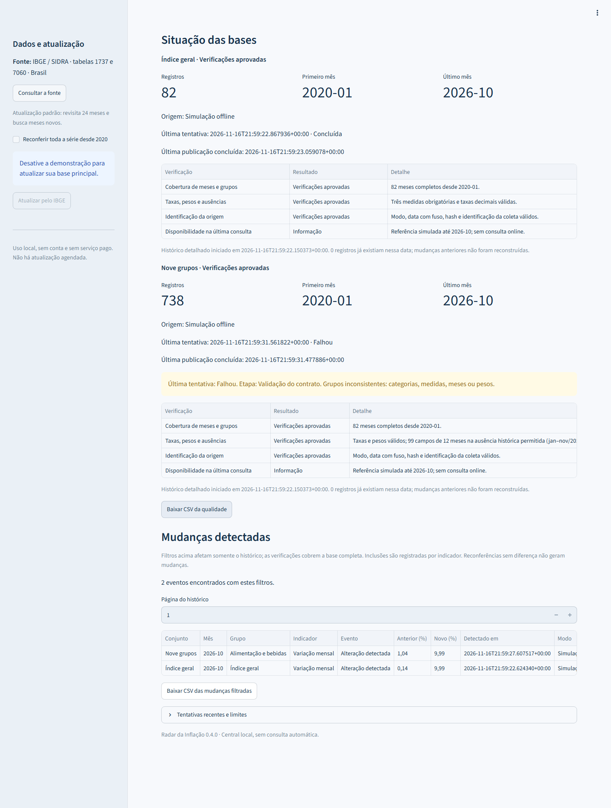
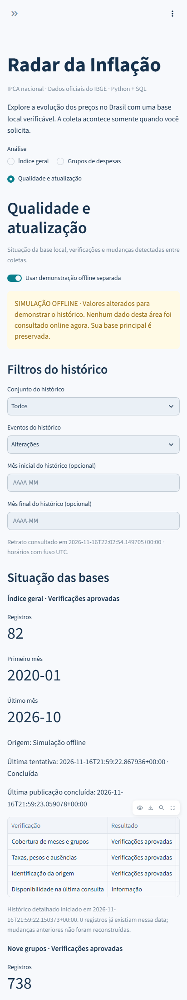
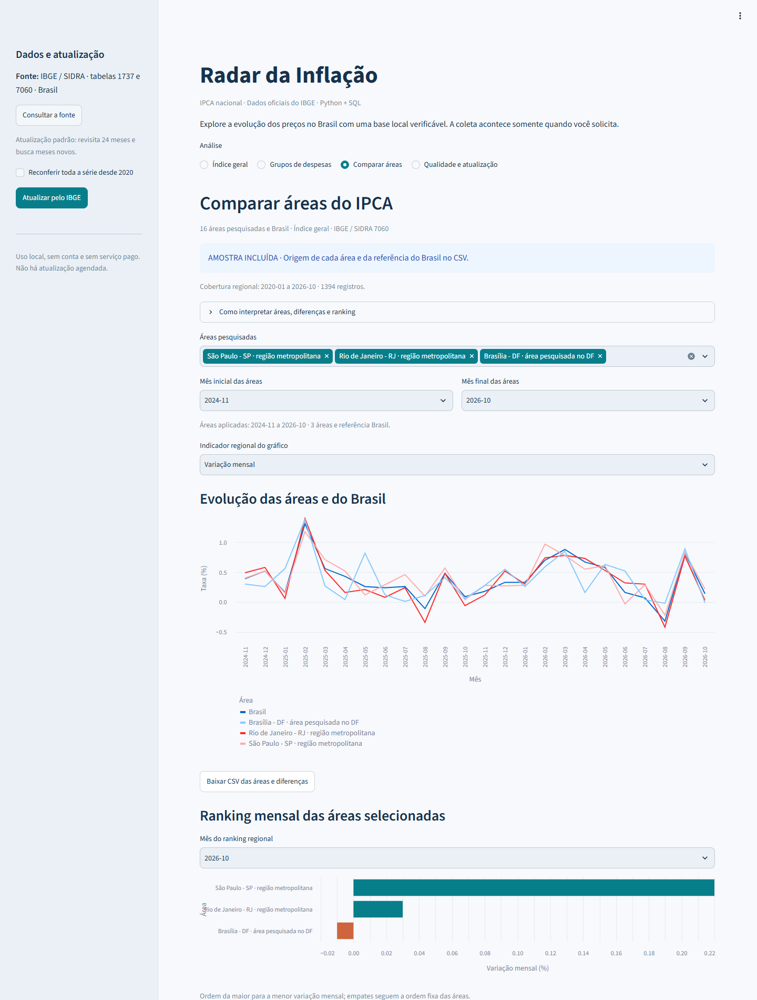
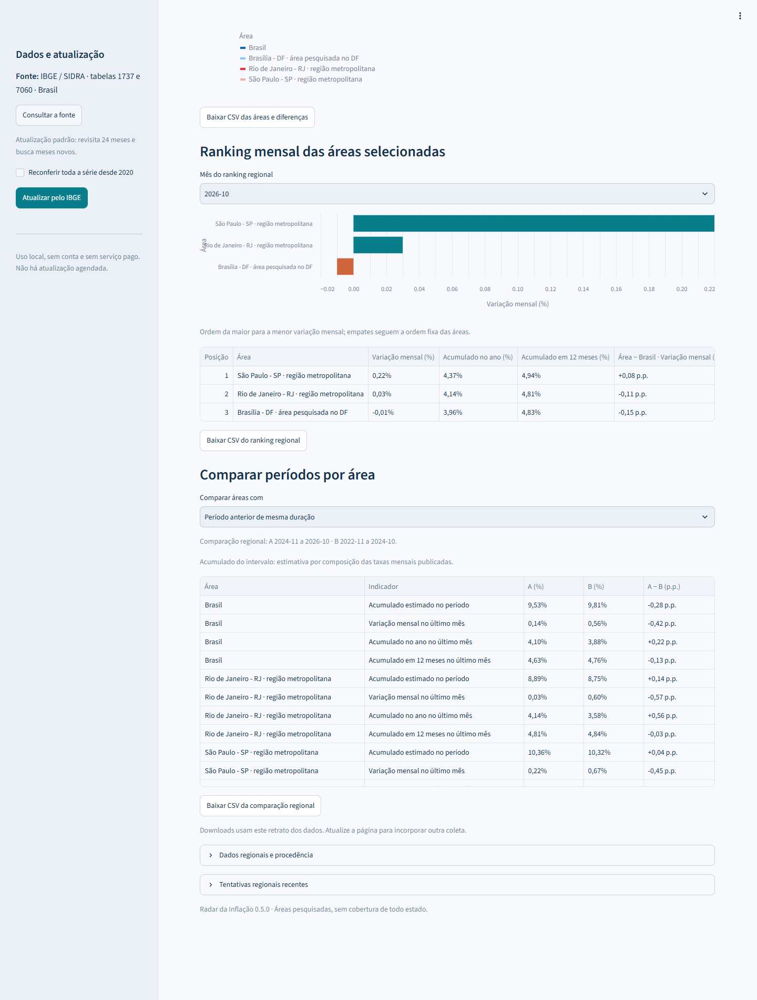
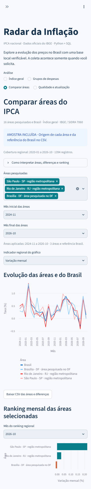
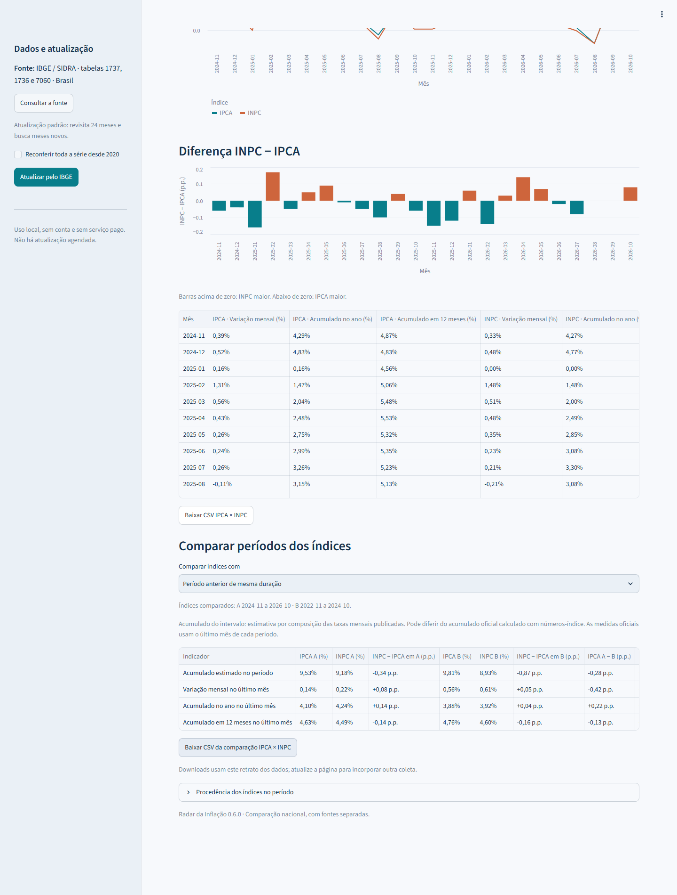
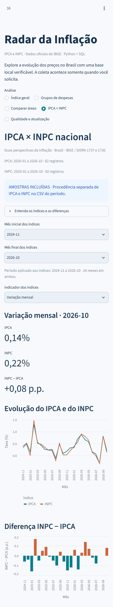

# Capturas da versão 0.2.1

Painel real local com a amostra oficial incluída, sem dados pessoais.

- Desktop: janeiro–março/2024 comparado a janeiro–março/2023; largura de 1440 pixels.
- Comparação: detalhe das janelas, estimativas, diferença em pontos percentuais e tabela.
- Mobile: período padrão, navegador emulado com largura de 412 pixels. Não houve teste em aparelho físico.

As imagens foram obtidas no navegador e conferidas visualmente. A estimativa do período é identificada separadamente dos valores oficiais.

## Grupos na versão 0.3.1

Capturas reais locais com a amostra da tabela 7060, janeiro–março/2024 e referência janeiro–março/2023. Nove grupos no desktop; três grupos iniciais no mobile emulado de 412 pixels. O ranking desktop usa janeiro/2024; o mobile usa o período padrão.

As capturas dos grupos foram refeitas na revisão 0.3.1, após os ensaios concorrentes. As imagens exibem os valores reais da amostra, sem as alterações sintéticas temporárias da base de ensaio.

## Central de qualidade — 0.4.1

Capturas reais em servidor local. A demonstração está ativada e explicitamente identificada; dados sintéticos são usados somente no exemplo separado. Desktop de 1440 pixels e mobile emulado de 412 pixels. A captura de mudanças mostra os eventos de antes/depois e a tentativa de grupos recusada.

As capturas da central foram atualizadas na revisão 0.4.1, incluindo a legenda dos filtros efetivamente aplicados. Os cenários continuam explicitamente simulados.

## Áreas do IPCA — 0.5.1

Capturas reais no Chromium local, com a amostra oficial de janeiro/2020 a outubro/2026. Seleção padrão São Paulo, Rio de Janeiro e Brasília, com Brasil no gráfico, período novembro/2024–outubro/2026. Ranking mensal de outubro/2026. Desktop 1440 pixels e mobile emulado 412 pixels, sem transbordamento da página. A tabela larga possui rolagem horizontal.

Capturas regionais atualizadas na revisão 0.5.1, após conferir filtros e os três downloads no navegador. A visualização mobile é emulação, não teste em aparelho físico.

## IPCA × INPC — 0.6.0

Capturas reais do Chromium local com as amostras oficiais de janeiro/2020 a outubro/2026. Tela inicial mostra novembro/2024–outubro/2026 e comparação com novembro/2022–outubro/2024. Brasil, tabelas 1737/1736. Desktop 1440 pixels e celular emulado 412 pixels; tabelas largas têm rolagem horizontal.

As barras de diferenças positivas e negativas foram verificadas após a correção de escape do nome do campo. Emulação não substitui teste em aparelho físico.
