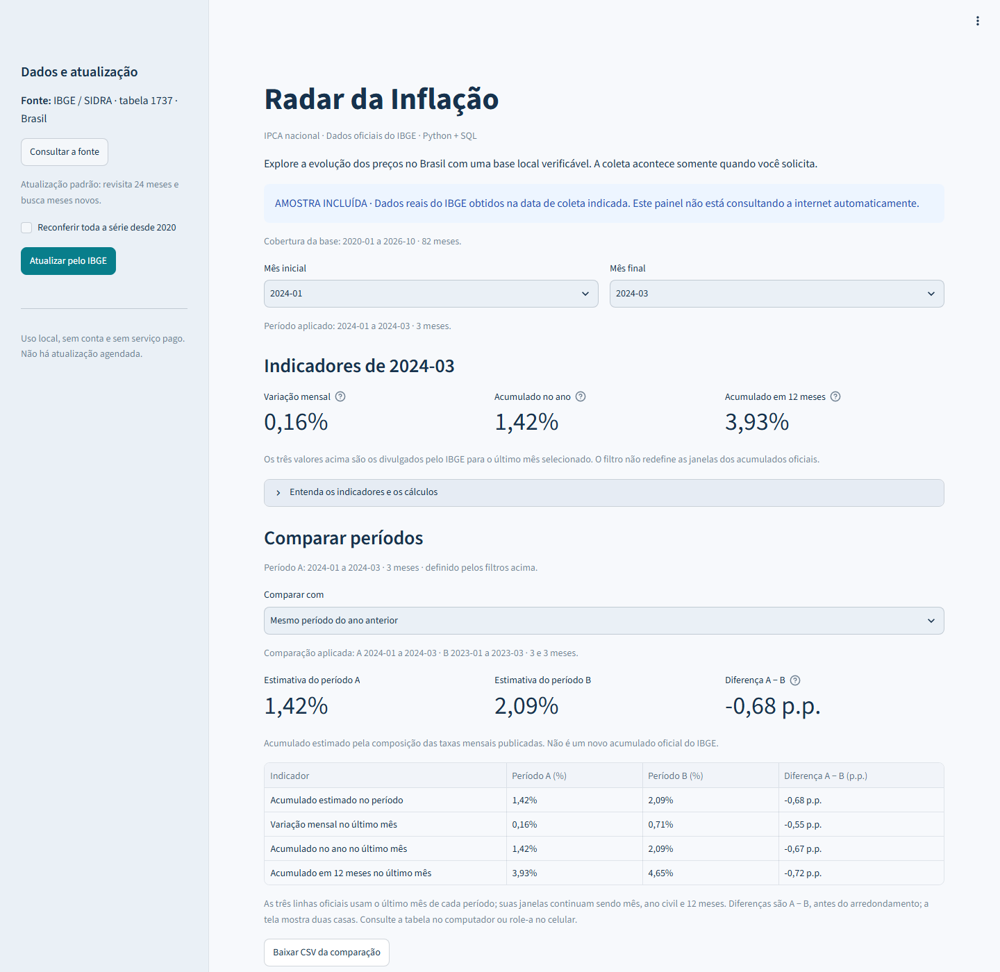
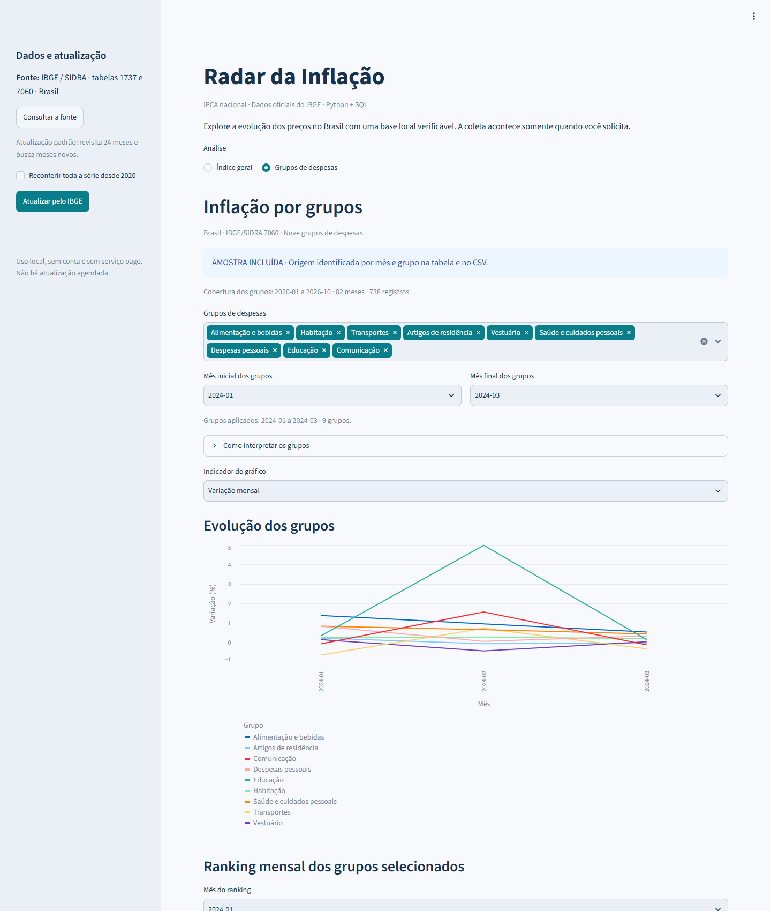
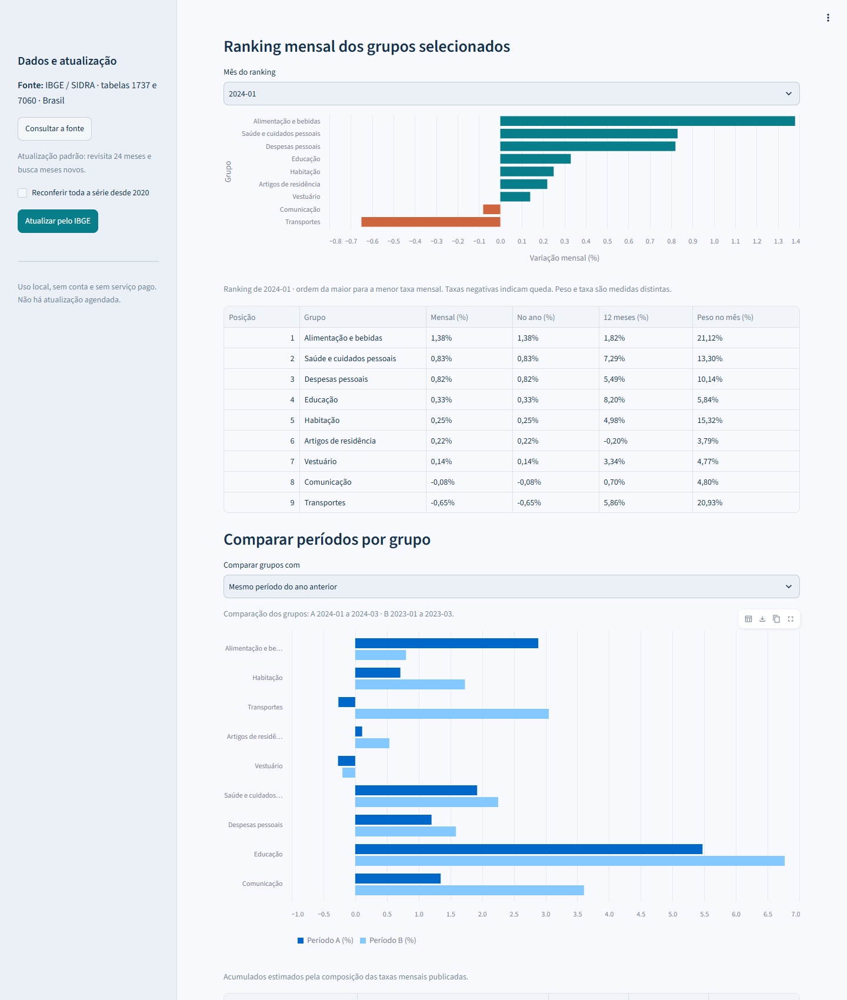
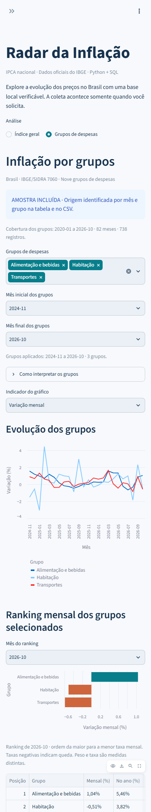

# Capturas da versão 0.2.1

Painel real local com a amostra oficial incluída, sem dados pessoais.

- Desktop: janeiro–março/2024 comparado a janeiro–março/2023; largura de 1440 pixels.
- Comparação: detalhe das janelas, estimativas, diferença em pontos percentuais e tabela.
- Mobile: período padrão, navegador emulado com largura de 412 pixels. Não houve teste em aparelho físico.

As imagens foram obtidas no navegador e conferidas visualmente. A estimativa do período é identificada separadamente dos valores oficiais.

## Grupos na versão 0.3.1

Capturas reais locais com a amostra da tabela 7060, janeiro–março/2024 e referência janeiro–março/2023. Nove grupos no desktop; três grupos iniciais no mobile emulado de 412 pixels. O ranking desktop usa janeiro/2024; o mobile usa o período padrão.

As capturas dos grupos foram refeitas na revisão 0.3.1, após os ensaios concorrentes. As imagens exibem os valores reais da amostra, sem as alterações sintéticas temporárias da base de ensaio.
